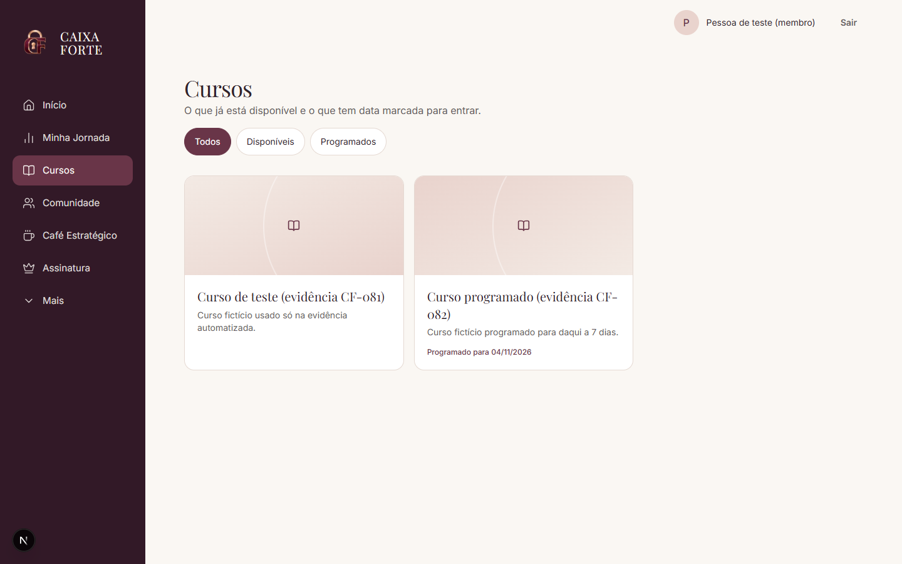
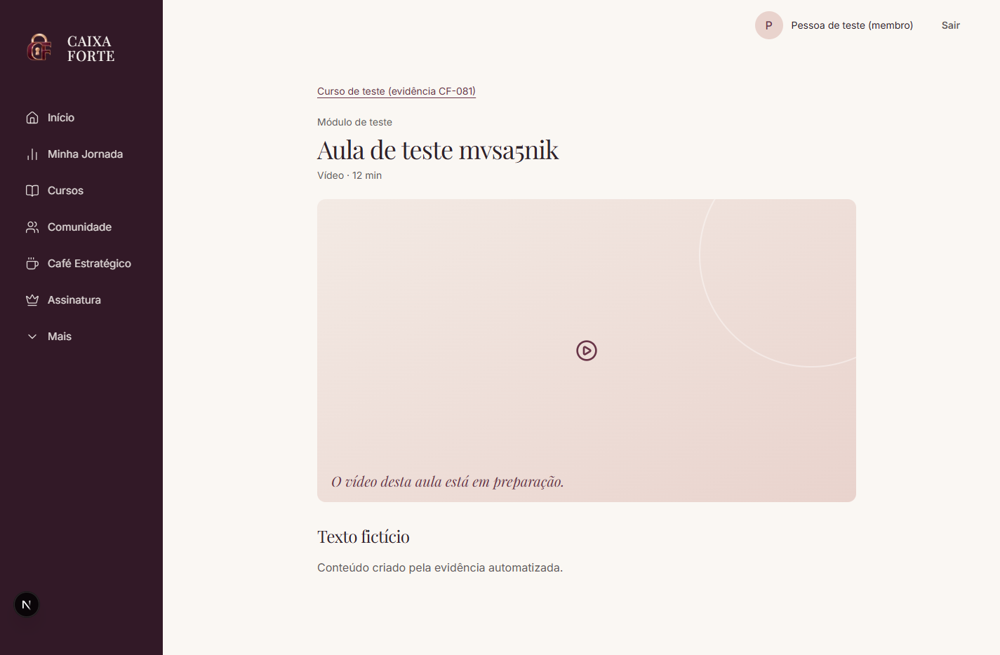
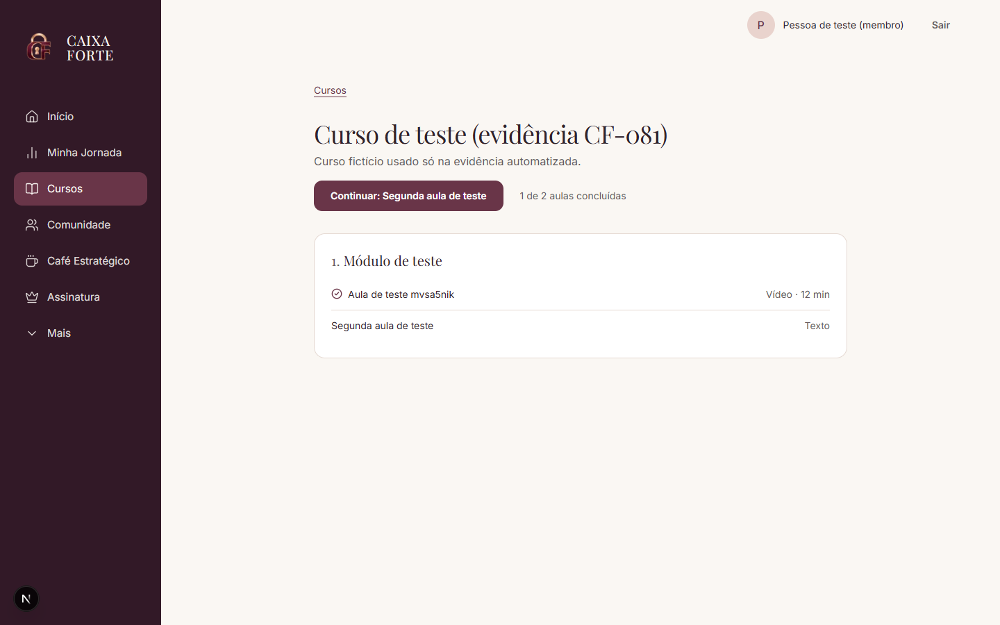
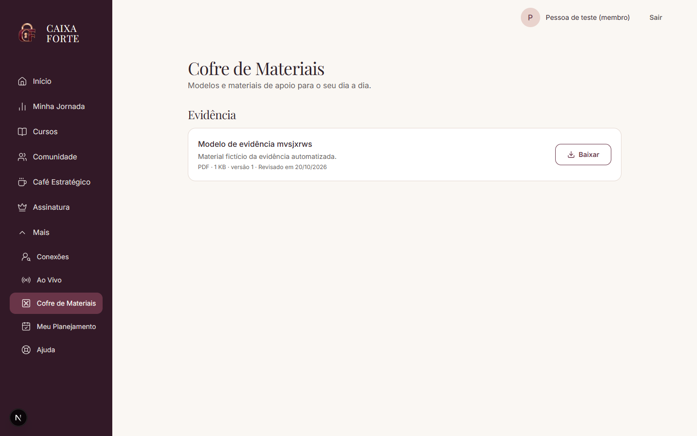
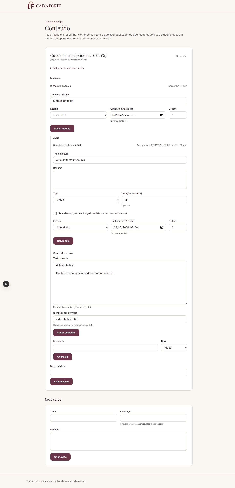
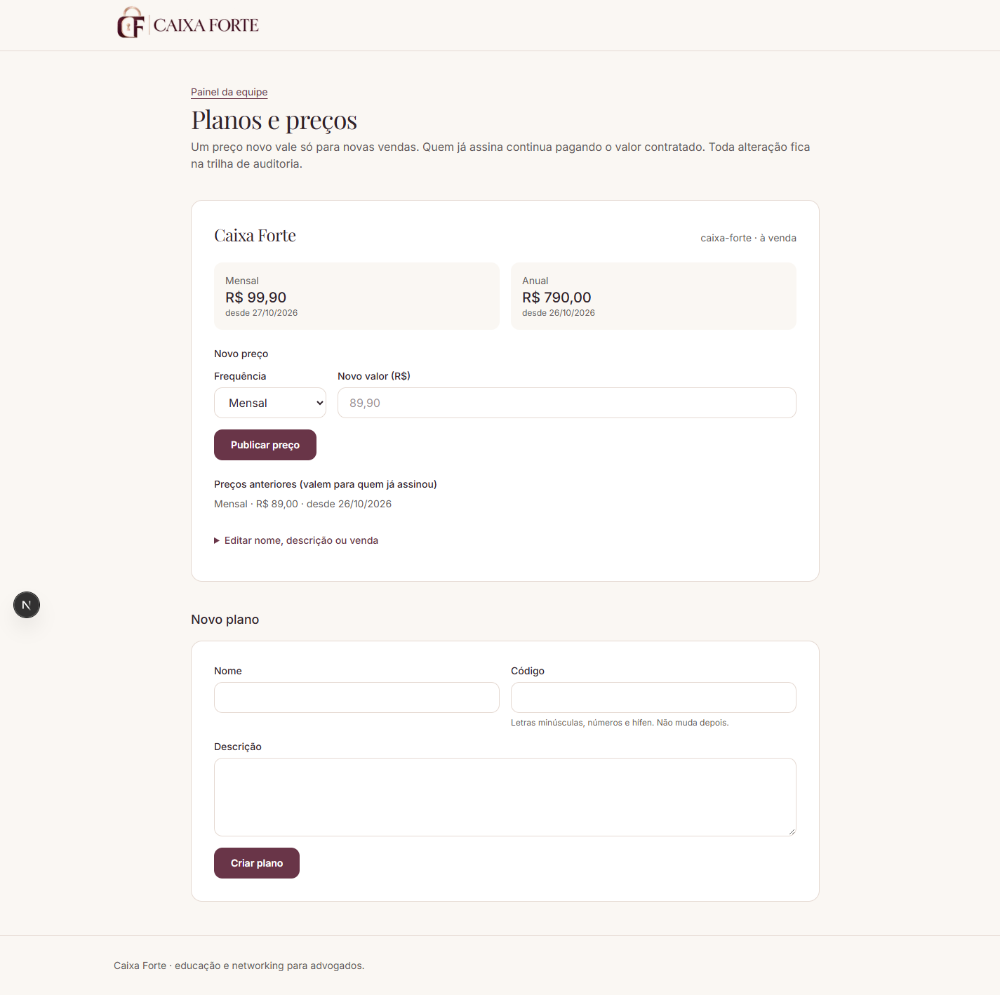
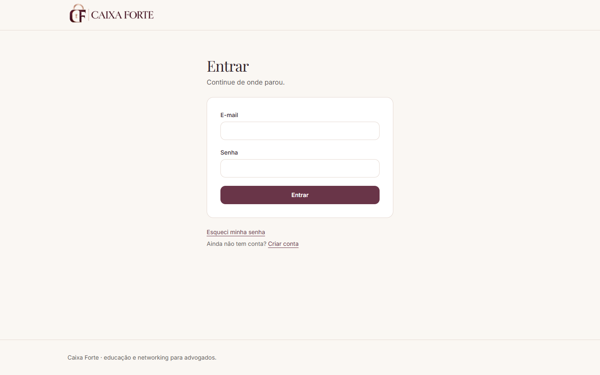
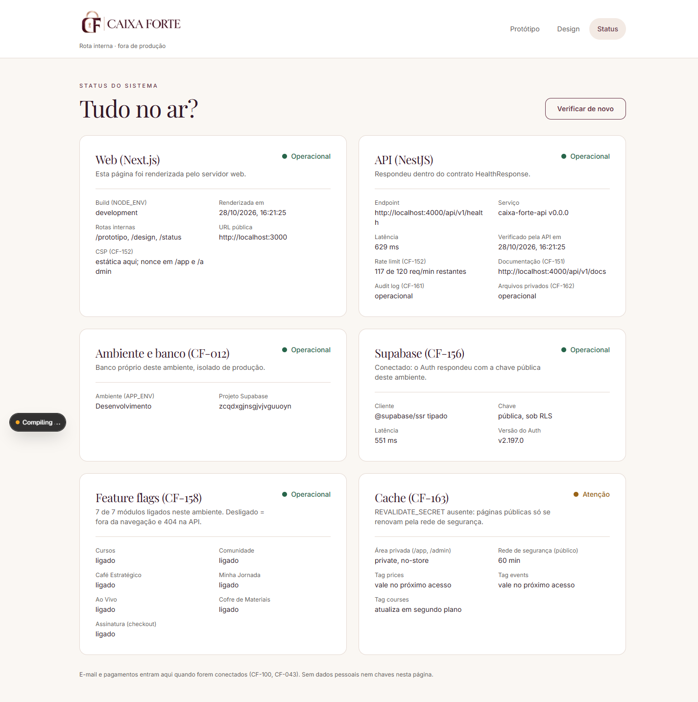

# Caixa Forte — Área de Membros

Comunidade premium de **educação e networking para advogados**: assinatura, cursos, Cofre de
materiais, comunidade sem mensagens privadas, jornada/planejamento e o **Café Estratégico**
(venda de ingresso, QR e check-in). Produto independente agora; integração com o portal Ellen
Conrado depois.

> Em desenvolvimento ativo. As telas abaixo são do ambiente de desenvolvimento, com **dados
> fictícios** de teste. Não há ambiente público no ar ainda (hospedagem: decisão P-014).

Documentação de produto em [`docs/`](docs/00_LEIA_PRIMEIRO.md) · ordem de execução em
[`docs/BACKLOG.md`](docs/BACKLOG.md) · regras de trabalho em [`CLAUDE.md`](CLAUDE.md)

## O que já funciona

### Para o membro

| Área               | O que faz                                                                                                                         |
| ------------------ | --------------------------------------------------------------------------------------------------------------------------------- |
| Conta              | Cadastro com consentimento LGPD, confirmação por e-mail, entrar, recuperar e redefinir senha                                      |
| Área do membro     | Menu minimalista (6 destinos + Mais), drawer no celular, estados vazios honestos onde a tela ainda não existe                     |
| Assinatura         | Mostra o acesso real (assinatura ou concessão), lido no servidor                                                                  |
| Cursos             | Catálogo com **disponíveis** e **programados com a data verdadeira**, filtro e página do curso                                    |
| Aulas              | Player com conteúdo **só para quem tem acesso** (ou aula aberta); vídeo por link assinado e temporário (provedor de vídeo: P-007) |
| Progresso          | Marcar aula como concluída, "Continuar: próxima aula", "x de y aulas concluídas" — só números reais                               |
| Cofre de Materiais | Materiais por assunto; **só assinantes baixam**, por link de 60 s gerado no clique                                                |

### Para a equipe (owner com verificação em duas etapas)

| Área             | O que faz                                                                                                        |
| ---------------- | ---------------------------------------------------------------------------------------------------------------- |
| Painel da equipe | Acesso por papel (owner, comercial, técnico); ações sensíveis exigem MFA                                         |
| Conteúdo         | Cursos, módulos e aulas sem deploy: rascunho, agendado (horário de Brasília) ou publicado; texto e vídeo da aula |
| Cofre            | Envio de arquivos direto ao bucket privado, com conferência do arquivo real; publicar, despublicar, excluir      |
| Planos e preços  | Planos e versões de preço para **novas** vendas, sem mexer em quem já assina                                     |
| Acessos          | Concessão manual de acesso com validade, motivo e revogação                                                      |
| Auditoria        | Toda alteração da equipe vai para uma trilha de auditoria imutável                                               |

### Ainda não existe (sem data prometida)

Pagamento e checkout (Stripe), e-mails transacionais (Resend), comunidade e diretório, encontros ao
vivo, Café Estratégico (ingresso/QR/check-in), jornada e planejamento completos, home final. A ordem
está em [`docs/BACKLOG.md`](docs/BACKLOG.md) §2.1.

## Telas

| Catálogo de cursos                                                  | Aula (player)                                                          |
| ------------------------------------------------------------------- | ---------------------------------------------------------------------- |
|  |           |
| **Progresso no curso**                                              | **Cofre de Materiais**                                                 |
|    |           |
| **Editor de conteúdo (owner)**                                      | **Planos e preços (owner)**                                            |
|  |  |
| **Entrar**                                                          | **Status do sistema**                                                  |
|                |                   |

Celular (390 px): [Cofre](docs/qa/screenshots/cf-085/cofre-assinante-390.png) ·
[Aula concluída](docs/qa/screenshots/cf-084/player-concluida-390.png) ·
[Sem assinatura](docs/qa/screenshots/cf-083/player-sem-acesso-390.png). Todas as evidências por
item ficam em [`docs/qa/screenshots/`](docs/qa/screenshots/).

## Segurança e privacidade

- **Autorização sempre no servidor**: papéis (RBAC), RLS no Postgres em toda tabela e paywall na
  API e no banco — nunca só na tela. `service_role` jamais no navegador.
- **Conteúdo pago protegido**: texto da aula só com acesso; vídeo e arquivos por **links assinados
  de vida curta**; bucket privado; nenhuma URL pública permanente.
- **Pagamento** só ativará acesso por webhook assinado e idempotente (ainda não integrado).
- **LGPD**: consentimento versionado, logs sem dados pessoais, diretório opt-in (planejado), sem
  mensagens privadas no MVP.
- **CI** em toda PR: lint, typecheck, testes, build, testes de RLS (pgTAP), auditoria de
  dependências, varredura de segredos (gitleaks) e SAST (Semgrep).

## Stack

pnpm + Turborepo · Node 24 · TypeScript strict · **Next.js 16** (App Router, Tailwind 4) ·
**NestJS 11** · **Supabase** (Postgres, Auth, Storage) · zod · Vitest e Jest · pgTAP.

```
apps/web           Next.js — rotas finas em src/app, lógica em src/modules/<contexto>
apps/api           NestJS — src/modules/<contexto>/{domain,application,infrastructure,presentation}
packages/ui        tokens do design v1.1 (sidebar vinho, canvas creme) + componentes
packages/contracts schemas zod compartilhados web ↔ api (+ tipos gerados do banco)
packages/config    tsconfig/eslint compartilhados
supabase/          migrations, testes de RLS (pgTAP), seeds e scripts fictícios
docs/              PRD, decisões, backlog, ADRs, QA, runbooks
```

Arquitetura limpa: as dependências só apontam para dentro (`domain` não conhece Nest, Next nem
Supabase). Decisões em [`docs/D_DECISION_LOG.md`](docs/D_DECISION_LOG.md) e
[`docs/adr/`](docs/adr/).

## Rodando localmente

Requisitos: Node **24** (`.nvmrc`) e pnpm **12**.

```bash
pnpm install
cp apps/web/.env.example apps/web/.env.local
cp apps/api/.env.example apps/api/.env
pnpm dev          # web http://localhost:3000 · api http://localhost:4000/api/v1/health
```

Sem Supabase configurado, web e API sobem com estados vazios honestos. Com um projeto Supabase de
desenvolvimento: `npx supabase db push --linked` (migrations), `pnpm seed:dev` (pessoas de teste
fictícias) e `pnpm storage:setup` (bucket privado). Rotas internas úteis: `/design` (componentes)
e `/status` (saúde de web, API e dependências).

| Script                                       | Descrição                                      |
| -------------------------------------------- | ---------------------------------------------- |
| `pnpm dev`                                   | web + api em modo watch                        |
| `pnpm check`                                 | format + lint + typecheck + testes + build     |
| `pnpm lint` / `pnpm typecheck` / `pnpm test` | gates de qualidade isolados                    |
| `pnpm openapi:export`                        | gera `docs/api/openapi.json`                   |
| `pnpm seed:dev` / `pnpm storage:setup`       | dados fictícios e bucket privado (dev/staging) |
| `pnpm branch:check`                          | valida o nome da branch (Git Flow)             |

## Como contribuir (Git Flow)

1. Issue real no GitHub.
2. Branch a partir de `develop`: `tipo/<numero-da-issue>-slug` (ex.: `feat/96-catalogo-cursos`).
3. Commits pequenos (Conventional Commits em português) e `pnpm check` verde.
4. PR para `develop` com `Closes #<issue>`, evidência e screenshots 1440/390 quando há tela.
5. CI verde + review (bloqueia só P0/P1, segurança e critério de aceite) → squash merge.
6. Release por PR `develop → main` com tag SemVer.

Detalhes: [`docs/H_GUIA_CLAUDE_CODE_GITFLOW.md`](docs/H_GUIA_CLAUDE_CODE_GITFLOW.md).
