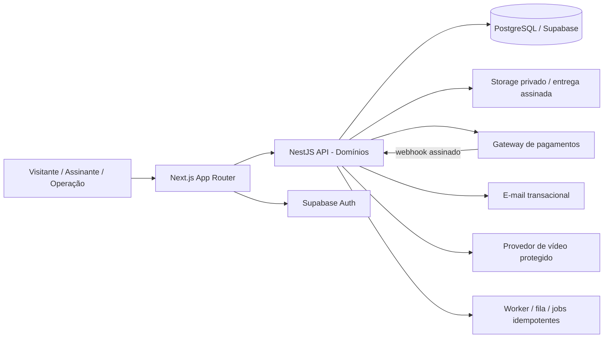
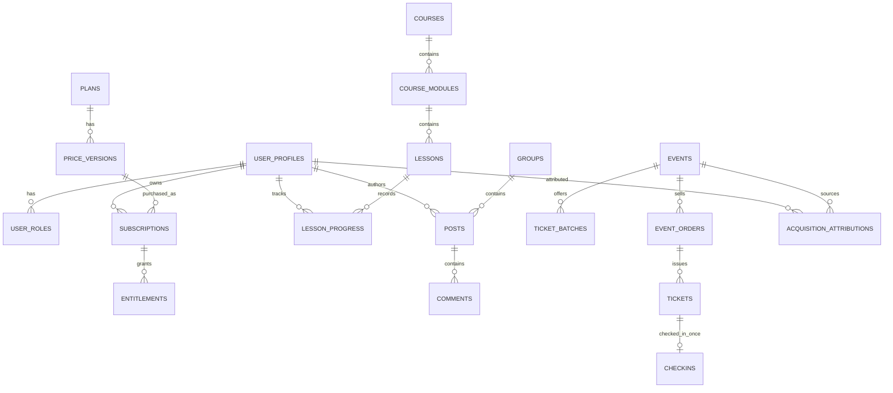

# CAIXA FORTE — PRD MASTER
**Product Requirements Document · v1.1 para validação de produto · 19/10/2026**  
**Produto:** Caixa Forte — comunidade premium de educação e networking para advogados  
**Proprietária do produto:** Ellen Conrado  
**Implementação técnica:** Luiggi (liderança técnica; responsabilidades formais a confirmar)  
**Escopo deste PRD:** plataforma própria **independente na primeira entrega**, incluindo Café Estratégico, com integração futura ao ecossistema Ellen Conrado  
**Status:** especificação pronta para refinamento técnico, **não** autorização para deploy sem homologação  
**Referências relacionadas:** `B_MVP_BLUEPRINT.md`, `C_DEVELOPMENT_BACKLOG.md`, `D_DECISION_LOG.md`, `E_ENGINEERING_DELIVERY_PLAN.md`, `F_QA_TEST_STRATEGY.md`, **`G_DESIGN_SYSTEM_MINIMALISTA.md`** e **`H_GUIA_CLAUDE_CODE_GITFLOW.md`**.

> **Convenções:** **[CONFIRMADO]** = resposta expressa da cliente ou restrição clara nesta conversa; **[PROPOSTO]** = sugestão a homologar; **[PENDENTE]** = decisão externa ou ainda não tomada. Toda informação comercial não testada é hipótese e não promessa. Arte gerada por IA é **referência estética, não arquivo de marca aprovado**, nem comprovação de pessoas ou números reais.

---

## 0. Resumo executivo e decisões de entrada

A Caixa Forte será uma **plataforma web própria** de assinatura e educação para advogados. Sua tese de valor é combinar **aprender + aplicar + planejar + conectar-se**, em uma interface elegante, moderna e acolhedora. O foco inicial de aquisição de membros são os **Cafés Estratégicos presenciais**, que também terão seu ciclo de divulgação, venda, ingresso digital e check-in dentro do software. Assinantes online podem existir, mas devem ser **identificados separadamente** das conversões oriundas de eventos.

**Decisões ratificadas em 15/10/2026:**

1. Desenvolver **Caixa Forte independentemente agora**; integrar depois ao projeto Ellen Conrado. **Não** bloquear MVP pela integração.
2. MVP central: **pagamento/acesso, cursos e networking**. Página de venda de eventos e check-in são P0 por serem o motor dos cafés.
3. Home pós-login equilibrada: **cursos + comunidade + jornada/planejamento**.
4. Networking inicial: perfis pesquisáveis, grupos, posts e comentários; **sem mensagens privadas**; DM somente futura.
5. Eventos: **vender ingressos, gerar tickets digitais e fazer check-in no próprio produto**.
6. Operação inicial: **Ellen (negócio), Luiggi (técnico), comercial (inscrições/atendimento)**, com permissões distintas.
7. Assinaturas de referência: **R$ 89 mensal** e **R$ 790 anual**, facilmente alteráveis no painel; renovação e parcelamento dependem de contrato/checkout homologado.
8. **Conteúdo progressivo**, sem fingir que aulas futuras já existem, e cronograma publicado aos assinantes.

**Outras premissas de posicionamento recuperadas:** advocacia solo e escritórios pequenos; conteúdos de primeiros clientes, atendimento, conversão, gestão, finanças, família e preparação para audiências; encontros coletivos e networking. **Seven Box separado** comercial e tecnicamente, com eventual link/cupom. Nome **Caixa Forte** é o nome de trabalho efetivamente utilizado; registro de marca, domínio e identidade final permanecem pendentes.

---

### 0.1 Revisão de design ratificada em 19/10/2026 — [CONFIRMADO]
A cliente rejeitou os mockups anteriores de dashboards densos e **aprovou a direção de visual minimalista, editorial e acolhedor** apresentada em `references/REFERENCIA_APROVADA_DASHBOARD_MINIMALISTA.png`. A imagem é referência de **composição e sensação**, não especificação pixel-a-pixel, fotografia licenciada, cadastro verdadeiro ou confirmação dos textos nela retratados.

**Regra de produto:** menos informação por tela, mais hierarquia, espaço em branco e ações claras. Preservar todas as capacidades do MVP já aprovadas (inclusive networking, assinatura e bilheteria), simplificando sua **exposição** nas telas do membro. Não retirar funcionalidades de negócio para atingir minimalismo. O projeto independente continua sendo o escopo inicial.

**Documentos de execução visual:** `G_DESIGN_SYSTEM_MINIMALISTA.md` (fonte de verdade para UI v1.1), `H_GUIA_CLAUDE_CODE_GITFLOW.md` (execução) e `CLAUDE.md` (instruções para o repositório).

# 01 — VISÃO GERAL

### 1.1 Problema e oportunidade
Advogados iniciantes, autônomos e pequenos escritórios frequentemente aprendem matérias jurídicas, mas carecem de um caminho concreto para estruturar rotina, captação profissional, atendimento, finanças, planejamento e relações com colegas. Conteúdo isolado tem baixa aplicação. A Caixa Forte entrega **continuidade após o Café Estratégico**: o diagnóstico presencial vira ação guiada, conteúdo e pares.

### 1.2 Proposta de valor
> **“Conhecimento, estratégia e conexões para construir uma advocacia mais organizada, sustentável e bem direcionada.”** [PROPOSTO — texto sujeito a refinamento editorial]

Pilares: **Aprender** (cursos); **Aplicar** (materiais e plano); **Conectar** (diretório e grupos); **Evoluir** (encontros e acompanhamento de progresso).

### 1.3 Público-alvo e exclusões
- **Persona A — Iniciante:** pouca previsibilidade de clientes; precisa de posicionamento, rotina e segurança no atendimento.
- **Persona B — Advocacia solo:** atende e executa tudo; precisa de organização, honorários, conversão e prioridades.
- **Persona C — Pequeno escritório:** já tem equipe; precisa de indicadores, delegação e planejamento.
- **Persona D — Operação interna:** Ellen, comercial, Luiggi, cada qual com permissões delimitadas.
- **Não é** marketplace de indicação de causas, CRM jurídico completo, rede social pública, consultoria jurídica individual ilimitada ou substituto do Seven Box. [PROPOSTO]

### 1.4 Modelo comercial
- Assinatura mensal e anual [CONFIRMADO como preços de referência] com planos modificáveis para vendas futuras.
- Café Estratégico: ingresso individual pago, lotes e limite por evento; independentemente da assinatura.
- Mentoria 1:1, produtos autônomos, patrocínios e benefícios do Seven Box: possibilidades futuras, **fora** do pacote padrão sem aprovação.
- Precificação inicial de um café-piloto [PROPOSTA histórica]: Ourinhos/SP, 26/11/2026, 18h30, 20 vagas; 6 ingressos a R$89 e 14 a R$109. **Local, data, quantidades e preços editáveis; publicar apenas após confirmação.**

### 1.5 Objetivo do MVP
Deve ser possível: cadastrar e cobrar membros; conceder e revogar acesso conforme pagamentos; publicar e consumir aulas/materiais; criar perfil e usar diretório/grupos sem DMs; cadastrar/vender evento com limites consistentes; emitir ingresso único; conferir check-in; ter visão administrativa real das operações. Tudo isso sem depender do site Ellen Conrado.

### 1.6 Evolução futura
Integração ao portal Ellen Conrado, melhoria do diagnóstico, metas, comunicação, eventos, ferramentas, gamificação, mentoria e networking. A integração futura não equivale automaticamente a mesclar bancos, pagamentos ou usuários: precisará de projeto de migração e SSO [PENDENTE].

# 02 — ESTRATÉGIA DE PRODUTO

### 2.1 Jobs to Be Done
| Perfil | Situação | Necessidade/resultado |
|---|---|---|
| Iniciante | “Não sei como começar” | Descobrir próximos passos, aulas e ações executáveis |
| Solo | “Tenho clientes, mas minha operação é desorganizada” | Padronizar rotina, atendimento e indicadores |
| Gestor | “Tenho equipe, porém não tenho visibilidade” | Aprender gestão e planejar melhoria |
| Participante de café | “Quero entrar e mostrar o QR” | Comprar ingresso, receber confirmação, fazer check-in sem atrito |
| Comercial | “Preciso apoiar inscrições” | Localizar comprador, verificar pagamento e conferir ingresso |
| Ellen | “Quero gerir cursos, comunidade e receita” | Publicar e acompanhar o negócio em uma administração controlada |

### 2.2 Jornadas principais
**J1 — assinatura direta:** landing → plano/preço → checkout → provedor confirma via webhook → entitlement ativo → onboarding → dashboard → aula e comunidade. Falha/pagamento pendente não libera conteúdo pago.

**J2 — assinante originado em café:** anúncio/convite → página evento → ingresso pago → QR digital → check-in → oferta **separada** Caixa Forte → compra da assinatura → vínculo de atribuição `origin_event_id`/`acquisition_channel=event`, independente de UTM. Não contar compra do ingresso como assinatura.

**J3 — aprendizado:** login → “Continuar aula” ou trilha → player → marcar progresso → recurso relacionado → retornar ao painel. Não há curso fictício publicado.

**J4 — networking:** completar perfil e consentir divulgação → explorar membros por cidade/área → entrar em grupo → publicar/comentar → moderar/denunciar. Dados de contato privados por padrão; sem DM.

**J5 — operação do evento:** Ellen cria evento rascunho → lotes/capacidade → publica → venda com reserva e expiração → pagamento → emissão → conferência no local → relatório.

**J6 — conteúdo progressivo:** Ellen publica curso/módulo; cada aula tem estado `rascunho`, `agendada`, `publicada`; cronograma é exibido de maneira verdadeira; notificar novos conteúdos por canal autorizado.

### 2.3 Métricas e definições
| Métrica | Fórmula/fonte | Cuidados |
|---|---|---|
| Membros ativos pagos | entitlements ativos + assinatura válida, excluindo trial se não definido | Não usar quantidade total de cadastros |
| MRR equivalente | mensalidades ativas + 1/12 do **valor nominal contratado** dos anuais ativos | É métrica gerencial; **não** saldo em caixa; contabilização, inadimplência e competência à parte |
| Receita recebida | eventos de liquidação financeira verificados | Tratar estornos, chargebacks e parcelamento real |
| Churn de membros | membros ativos no início que perderam acesso / membros ativos no início | Separar fim natural do anual, falha e cancelamento |
| Conversão café→comunidade | assinaturas pagas atribuídas ao evento / participantes com check-in | Exibir janela de atribuição configurável e evitar duplicidades |
| Ocupação | tickets confirmados / capacidade | Pendente não conta como venda final |
| Comparecimento | tickets válidos usados / tickets pagos válidos | Cancelados/estornados excluídos |
| Ativação de aprendizado | membros que concluíram a 1ª aula / novos membros válidos no período | Denominador preciso |
| Engajamento comunidade | membros únicos que postaram/comentaram / membros habilitados | Nunca exibir número inventado |
| CAC por café | custos atribuídos ao evento / assinaturas originadas dele | Separar custos do café, receita de ingressos e retenção |

**Metas:** referência gerencial histórica de crescer até R$10.000 de lucro mensal **somente de assinaturas oriundas dos cafés** [aspiração, não requisito garantido]. Visitas e inscrições online não serão imputadas aos cafés sem rastreabilidade.

### 2.4 Hipóteses, riscos, dependências
- Retenção depende da agenda de conteúdo e networking; lançamento progressivo transparente.
- Intermediação de pagamentos, parcelamento anual e repasse são dependências **não contratadas ainda**.
- Vídeo requer solução compatível com proteção/autorização e custo; não assumir distribuição pública pelo Storage.
- Catálogo só inclui materiais reais. A data do piloto depende da operação e da disponibilidade da infraestrutura.
- Observância da LGPD, de direitos autorais dos materiais e de regras profissionais pertinentes às comunicações jurídicas, avaliadas em etapa de compliance.

# 03 — ESCOPO FUNCIONAL

**Convenção comum a todos os módulos:** componentes devem ter estados `loading`, `empty`, `error`, `success`, `access_denied` quando pertinente; formulários validam no cliente por UX e **no servidor** por segurança; buscas são paginadas e não expõem campos privados; `created_at/updated_at` persistidos em UTC e convertidos para fuso local na UI. Requisições mutantes sensíveis são idempotentes sempre que aplicável. Direitos de edição são conferidos no servidor.

## CF-01 — Site público e página da comunidade [P0]
- **Objetivo:** explicar promessa, conteúdo realmente liberado, encontros previstos, credenciais de Ellen, valores, FAQ e CTA para pagamento.
- **Atores:** visitante, Ellen (editora), comercial (consulta).
- **Tela/entrada:** `/`, `/planos`, `/entrar` na aplicação independente; rotas finais configuráveis.
- **Campos:** título, subtítulo, descrição, módulos públicos, planos atuais, FAQ, SEO/social preview, termos, privacidade, CTAs.
- **Regras:** preços vêm do catálogo persistido; preço de checkout deve coincidir com versão do plano escolhida; conteúdo “em breve” identificado; nenhum depoimento, números, certificações ou vagas fabricados.
- **Exceções:** plano inativo remove CTA de venda; checkout fora de serviço mostra orientação e não simula venda.
- **Aceite:** visitante visualiza plano ativo, acessa checkout e consegue ler termos em desktop/mobile.

## CF-02 — Contas, identidade e onboarding [P0]
- **Atores:** visitante, membro, proprietário, comercial, técnico.
- **Fluxo:** cadastro ou convite → verificação/recuperação → autenticação → aceite dos termos → completar perfil básico → preferências privadas → dashboard.
- **Dados:** `auth_user_id`, nome, email normalizado, cidade/UF, áreas de interesse, carreira (iniciante/solo/equipe), papel de acesso, consentimentos com versão e data.
- **Autorização:** visitante vê apenas público; membro vê conteúdo de seu entitlement; comercial não recebe acesso a cursos exclusivos por ser comercial; técnico não recebe privilégios financeiros automaticamente.
- **Segurança:** políticas fortes, confirmação e recuperação de e-mail, gestão de sessão; proteção contra enumeração de contas, abuso e login excessivo. MFA obrigatório para administradores recomendado P0.
- **Aceite:** usuário sem assinatura não reproduz vídeos privados por URL; alteração de papel por cliente é rejeitada; onboarding retoma caso interrompido.

## CF-03 — Planos, cobrança e entitlement [P0]
- **Preço-base:** `MENSAL=R$89`, `ANUAL=R$790` [CONFIRMADO]; configuração e preços futuros gerenciáveis sem deploy.
- **Separar conceitos:** `plan` (produto), `price_version` (valor/moeda/frequência), `subscription` (contrato no provedor), `payment` (transação), `entitlement` (permissão de acesso). Não alterar retroativamente contratos vigentes ao editar preço.
- **Estados mínimos:** `pending`, `active`, `past_due`, `cancel_at_period_end`, `canceled`, `refunded`, `suspended`; mapeamento preciso conforme gateway contratado.
- **Mensal:** renovação recorrente e tentativa de cobrança segundo regra documentada do provedor.
- **Anual:** valor anual contratado; parcelas de até 12 **apenas se processador suportar**; política de renovação automática, consentimento, cancelamento e repasse a homologar. Não confundir parcelas com 12 renovações mensais.
- **Regras:** webhooks assinados, deduplicados (`provider_event_id` único), mudança de estado controlada e reconciliável; nunca ativar por retorno visual do checkout; respeito a estornos e chargebacks; concessões manuais auditadas, com validade.
- **Admin:** criar/ativar/desativar plano, alterar **novas versões** de preço, visualizar assinaturas; comercial somente visualiza situação necessária para atendimento, sem detalhes financeiros sensíveis desnecessários.
- **Aceite:** compra confirmada libera acesso uma vez; webhook duplicado não duplica matrícula; pagamento recusado não ativa; reembolso invalida entitlement conforme regras; mudança de preço não altera contrato existente.

## CF-04 — Home / Meu Painel [P0]
- **Proposta visual:** equilíbrio entre **continuar aula**, **minha jornada**, **próximo encontro**, **comunidade/conexões**. Não transformar home em catálogo somente de cursos.
- **Cards:** saudação personalizada; “Continuar de onde parei”; objetivo em andamento (se preenchido); próximo encontro publicado; 2–3 grupos e posts recentes autorizados; atalhos materiais e eventos.
- **Dados:** progressão real, schedule real, permissão de associação e posts moderados.
- **Estados:** novo usuário recebe CTA “Começar minha jornada”, sem barras em 62% fictícias; evento inexistente não vira evento falso; erro de módulo não derruba a página toda.
- **Aceite:** cards respeitam autorizações e navegam à tela correspondente; painel mobile utilizável.

## CF-05 — Trilhas, cursos, módulos e aulas [P0]
- **Objetivo:** publicar conteúdos progressivamente sem alterar código.
- **Modelo:** `track` → `course` → `module` → `lesson`, ordenáveis; uma aula contém título, texto, mídia segura, duração estimada, recursos, status, `publish_at` opcional, permissões do plano.
- **Player:** retomar aula, progresso por usuário, concluído/não concluído, material de apoio, voltar ao curso, próxima aula publicada.
- **Tipos MVP:** vídeo hospedado com acesso controlado e aula texto. Conteúdo multimídia extra P1.
- **Regras:** estados rascunho/programado/publicado; nunca mostrar item como liberado antes da publicação; editor consegue alterar ordenação; impedir fuga de URLs privadas; horários em UTC.
- **Aceite:** Ellen cria um curso e uma aula sem código; membro assiste e conclui; revisão/republicação não apaga progresso indevidamente; conta vencida não acessa.

### 3.5.1 Biblioteca editorial planejada — lançamento progressivo
| Trilha/curso | Aulas planejadas | Status inicial proposto |
|---|---|---|
| 01. Comece Aqui | Boas-vindas; como usar; diagnóstico; meta 30 dias | Lançamento P0 |
| 02. Primeiros Clientes | Posicionamento; visibilidade profissional; presença digital; relacionamentos; plano 30 dias | Lançamento P0 |
| 03. Atendimento e Conversão | Primeiro contato; consulta; diagnóstico; honorários; acompanhamento; métricas | Lançamento P0 |
| 04. Planejamento 2027 | Resultados 2026; áreas de diagnóstico; metas 90 dias; plano 30 dias | Lançamento P0 |
| 05. Gestão da Advocacia Solo | Rotinas; agenda; organização; delegação; ferramentas | Conteúdo posterior |
| 06. Finanças e Honorários | Custos; fluxo de caixa; honorários; inadimplência | Conteúdo posterior |
| 07. Família na Prática | Alimentos; divórcio; guarda; documentos; estratégia de atuação | Conteúdo posterior |
| 08. Audiências e Provas | Preparação; provas; perguntas; audiência; pós-audiência | Conteúdo posterior |
| Tecnologia e IA | Automação responsável; fluxos, produtividade e proteção de informações | Possível evolução de catálogo |

**Publicação gradual:** expor `disponível`, `programado para data X` ou `planejado sem data`; nunca atribuir “concluído” a conteúdo indisponível. Não prometer acervo finalizado no checkout se ainda não estiver entregue.

## CF-06 — Materiais / Cofre [P0]
- **Objetivo:** biblioteca de ferramentas baixáveis, com categorias e controle de acesso.
- **Dados:** arquivo, versão, assunto, tipo, licença, data da revisão e associação a curso.
- **Política:** arquivos privados no storage, URL temporária autenticada, validação de tamanho/tipo e varredura antimalware conforme viabilidade; documentos protegidos contra indexação e compartilhamento acidental.
- **Aceite:** um membro ativo pode baixar arquivo permitido; visitante/expirado não; URLs não permanecem públicas indefinidamente; exclusão administrativa preserva auditoria.

## CF-07 — Networking: perfis e diretório [P0]
- **Objetivo:** encontrar colegas por cidade/UF e áreas de atuação.
- **Campos públicos opt-in:** primeiro nome/nome profissional, foto, cidade/UF, especialidades, apresentação curta, links consentidos. E-mail, telefone e endereço não expostos automaticamente.
- **Filtros:** cidade, UF, área, carreira (conforme adesão); busca textual com paginação; limitação de consultas abusivas.
- **Regra:** consentimento específico para aparecer no diretório; ocultação/remoção a pedido; bloqueio para não assinantes; não permitir coleta massiva.
- **Aceite:** membro sem consentimento não consta em busca; filtros corretos; exclusão/ocultação imediata do diretório após atualização.

## CF-08 — Grupos e publicações [P0]
- **Objetivo:** interação entre participantes sem chat privado.
- **Grupos iniciais propostos:** Advocacia Solo, Primeiros Clientes, Direito de Família, Gestão e Finanças, Tecnologia e IA, grupos por região quando houver escala.
- **Operações:** entrar/sair de grupo aberto a membros, visualizar posts, publicar texto, comentar, denunciar, editar/excluir o próprio post, moderação administrativa. Arquivos em posts P1; reações P1.
- **Regras:** só membros com acesso ativo; proibir dados sigilosos de clientes e conteúdo ilícito; limites de volume; trilha de moderação (`open`, `reviewed`, `resolved`, `dismissed`); exclusão lógica e auditoria proporcional.
- **Aceite:** membro publica/comenta, usuário expirado recebe bloqueio; moderação remove visibilidade; denúncias não expõem denunciante a demais usuários.
- **Explicitamente fora do MVP:** mensagem direta 1:1, chamadas privadas, grupos pagos separados, recomendações por IA.

## CF-09 — Encontros online [P0 mínimo; recursos avançados P1]
- **MVP:** calendário administrativo, página do encontro, link de sala externa protegido para membros, data/fuso correto, status e gravação posterior autorizada.
- **P1:** inscrição com vagas, reminders sofisticados, interações durante transmissão, reprodução nativa.
- **Aceite:** somente membros autorizados visualizam link privado; evento cancelado mostra status correto; dados de encontros futuros são reais.

## CF-10 — Planejamento, diagnóstico e jornada [P0 básico; P1 aprofundado]
- **MVP:** diagnóstico de 5–10 perguntas sobre estágio, aquisição, atendimento, organização, finanças e metas; objetivo de 90 dias; até 3 ações de 30 dias com status (`to_do`, `doing`, `done`). Se não preenchido, mostrar convite para começar.
- **P1:** histórico comparativo, 7 áreas detalhadas, evolução por indicadores e recomendações contextuais; automação inteligente P2.
- **Regras:** não penalizar perfil solo por não ter equipe; resultado é autoavaliação, não diagnóstico técnico/jurídico conclusivo; informações privadas.
- **Aceite:** usuário salva/edita plano; outro membro jamais consegue consultar suas metas; painel mostra dado real mais recente.

## CF-11 — Café Estratégico: eventos e vendas [P0]
- **Responsável:** Ellen cria/edita; comercial monitora vendas e presença; técnico opera suporte autorizado.
- **Dados:** slug, cidade/UF, local/endereço, data/hora/fuso, descrição, imagens reais, lote, preço, capacidade, status (`draft`, `interest_list`, `published`, `sold_out`, `completed`, `canceled`).
- **Lotes:** quantidade absoluta, preço versionado e janelas opcionais. Reservas de checkout têm TTL; compra confirmada consome capacidade; atrasos/pagamentos após expiração exigem reconciliação/reembolso ou solução controlada, **nunca overbooking silencioso**.
- **Compra:** CPF e campos fiscais apenas quando necessários, nome e e-mail participante, contato para confirmação, política de cancelamento, aceite dos termos; compra de ingresso **não** ativa assinatura.
- **Ingresso:** UUID/ID único, token assinado/opaco no QR Code, nome, edição, status. Não imprimir dados pessoais no QR. E-mail transacional com reenviar ingresso seguro; WhatsApp pode ser link manual no MVP ou integração autorizada P1.
- **Check-in:** consulta por QR/nome; autorizado somente equipe; operação atômica `unused → used` com carimbo; impedir reutilização, conferir ingresso de outro evento, registrar operador; modo offline não é requisito do MVP (precisará de internet no local).
- **Pós-evento:** consentimento de comunicações, atribuição das assinaturas à edição de origem; atribuição manual auditável somente por Ellen se fonte comprovada.
- **Aceite:** primeira compra dentro de lote válida, 21ª venda bloqueada se capacidade=20; duas tentativas de check-in do mesmo QR não entram duas vezes; cancelamento/invalidação bloqueia QR; vendas pendentes não aparecem como receita confirmada.

## CF-12 — Painel administrativo e comercial [P0]
- **Ellen — owner:** CRUD de cursos, materiais, eventos, planos/preços para novas compras, equipe, regras de conteúdo, relatórios financeiros e de conversão, reembolso com ação segura delegada ao gateway.
- **Comercial:** ver inscrições/status, suporte de ingressos, reenviar confirmação, realizar check-in, ver informações mínimas para atendimento; **sem editar planos, acessos financeiros, roles ou conteúdo editorial**.
- **Luiggi — técnico:** acesso à configuração técnica necessário para deploy/QA e manutenção; privilégios de produção e dados pessoais mínimos, temporários/auditados. Não herdar o papel de owner automaticamente.
- **Painel:** filtros por período, status real, KPIs úteis, lista de eventos, conteúdo, membros e moderação. Sem métricas inventadas.
- **Aceite:** comercial não altera valores via API; toda alteração crítica contém audit trail; owner ativa/desativa plano sem tocar no código.

## CF-13 — Comunicação, suporte e consentimentos [P0 transacional; P1 avançado]
- **P0:** e-mails de confirmação, ingresso, recuperação de acesso, comprovantes/status de pedido; centro de ajuda/contato; política de privacidade e preferências de comunicação.
- **P1:** newsletter, alertas de novos cursos, lembretes e WhatsApp automatizado com consentimento e fornecedor contratado.
- **Política:** distinguir comunicação necessária à compra de marketing opt-in; permitir descadastro de marketing; processar bounces sem expor dados.

## CF-14 — Integração ao Ellen Conrado e Seven Box [P1/P2]
- **P1:** integrar navegação, identidade e domínio do portal Ellen Conrado após o MVP; desenhar SSO/migração de conta sem comprometer IDs de membros e assinaturas.
- **P2:** experiências conjuntas de conteúdo e indicações; benefício/cupom Seven Box condicionado a acordo comercial.
- **Proibição:** integração não pode conceder acesso ao Seven Box sem contratação; não usar bases internas do escritório jurídico na comunidade.

## CF-15 — Mensagens privadas, desafios e inteligência [P1/P2]
- **P1:** DM sob requisitos de privacidade/moderação, histórico de leitura e antiabuso; desafios, grupos regionais aprofundados, encontros com inscrição, notificações.
- **P2:** recomendações avançadas, gamificação elaborada, matching, assistente IA e estudos de comportamento; dependem de uso real e avaliação LGPD.

# 04 — NAVEGAÇÃO E ARQUITETURA DE INFORMAÇÃO

### 4.1 Menus do assinante — navegação progressiva minimalista [CONFIRMADO: direção visual; PROPOSTO: agrupamento específico]
A funcionalidade aprovada continua acessível, mas o **menu lateral não deve expor dez opções com o mesmo peso visual**. Navegação desktop preferencial, até seis destinos no primeiro nível: **Início**, **Minha Jornada**, **Cursos**, **Comunidade**, **Café Estratégico** e **Assinatura**. A opção **Mais** (ou grupos recolhíveis sob os títulos *Aprender*, *Conectar*, *Conta*) oferece **Conexões**, **Ao Vivo**, **Cofre de Materiais**, **Meu Planejamento**, **Ajuda** e **Perfil**. Evitar profundidade maior que dois níveis nas rotas P0. Todos os recursos P0 continuam alcançáveis em 1–2 interações de navegação.

**Mobile:** menu compacto / drawer acessível; se houver barra inferior, no máximo quatro destinos + Mais, com nomes claros. Cabeçalho sem excesso de ícones. O acesso ao Café público e sua compra não podem depender de estar logado. **Admin:** layout administrativo separado e funcional, sem forçar a mesma densidade da home editorial de membros. Nunca esconder tarefa crítica, erro, pagamento ou aviso de privacidade para cumprir quota estética.

### 4.2 Sitemap e rotas propostas (adaptáveis após auditoria de repositório)
```text
/                             Página pública Caixa Forte
/planos                       Comparativo e contratação
/entrar | /cadastro            Autenticação
/eventos                      Edições públicas Café Estratégico
/eventos/[slug]               Página comercial da edição
/checkout/assinatura          Inicia checkout de plano (server action/API)
/checkout/ingresso            Inicia checkout de ingresso (server action/API)
/compra/[id]/status           Confirmação consultada no servidor
/ingresso/[id]                Visualização autenticada/por link seguro do ingresso
/app                          Home do membro
/app/jornada                  Onboarding/diagnóstico
/app/cursos                   Catálogo
/app/cursos/[slug]            Curso/módulos
/app/aulas/[id]               Player
/app/conexoes                 Diretório
/app/conexoes/[profileId]     Perfil opt-in
/app/comunidade               Grupos/feed
/app/comunidade/grupos/[slug] Grupo e posts
/app/ao-vivo                  Calendário e gravações
/app/materiais                Biblioteca
/app/planejamento             Metas 30/90 dias
/app/assinatura               Contrato e situação
/app/perfil                   Privacidade e preferências
/app/ajuda                    Suporte
/admin                       Painel protegido owner
/admin/conteudos              Gestão de cursos, aulas e materiais
/admin/membros                Membros / contratos / perfis
/admin/eventos                Edições e lotes
/admin/eventos/[id]/checkin   Conferência para equipe
/admin/moderacao              Denúncias
/admin/relatorios             Métricas reais
/admin/configuracoes          Planos, branding, permissões e políticas
```
**Observação:** no futuro usar roteamento dentro do portal Ellen Conrado, **não** renomear rotas em produção sem redirects e estratégia de SSO.

### 4.3 Wireframe aprovado como direção: poucas informações, muita clareza
```text
┌─ NAV VINHO ──────────┬─ CANVAS CREME CLARO ───────────────────────────────────────┐
│ símbolo simples      │ Busca discreta                   Avisos        Perfil         │
│ Caixa Forte          │                                                           │
│                     │ BOAS-VINDAS + título editorial + frase curta              │
│ • Início             │ [imagem suave / natureza-morta discreta; não foto fake]     │
│ • Minha Jornada      │                                                           │
│ • Cursos             │ [MINHA JORNADA / ÚNICA AÇÃO PRINCIPAL: Continuar]         │
│ • Comunidade         │                                                           │
│ • Café Estratégico   │ CURSOS EM DESTAQUE                       Ver todos         │
│ • Assinatura         │ [Curso 1]        [Curso 2]         [Curso 3]             │
│ · Mais               │                                                           │
│                     │ [Próximo encontro]         [Comunidade / Conexões]         │
└─────────────────────┴───────────────────────────────────────────────────────────┘
```
**Regra de carga:** no máximo **1 hero + 1 card de jornada + 3 cards de curso + 2 cartões auxiliares** na tela inicial padrão; não montar painéis de KPI, gráficos, feeds inteiros e cinco carrosséis simultâneos. Dados detalhados ficam nas telas correspondentes. Uma seção pode ser substituída por outra contextual se fizer mais sentido ao estado do usuário, respeitando a mesma densidade visual.

**Estados:** primeiro acesso substitui “Continuar” por “Começar diagnóstico”; nenhuma aula iniciada sugere curso publicado; sem evento, ocultar bloco ou mostrar convite verdadeiro; comunidade sem publicações apresenta CTA de participação, nunca números fictícios. Os elementos do mock são sintéticos e **não representam a foto real de Ellen, membros reais ou progressos medidos**.

# 05 — DASHBOARDS E INTELIGÊNCIA VISUAL

### 5.1 Painel do membro — informação por prioridade (minimalista)
| Prioridade visual | Bloco | Fonte real | Regra de UI e interação | Empty/error/visibilidade |
|---|---|---|---|---|
| 1 | Boas-vindas/hero editorial | marca + nome do perfil + asset autorizado | título curto, subtítulo e imagem discreta; sem números | erro de imagem usa fundo sólido; jamais retrato sintético apresentado como real |
| 2 | Minha Jornada — CTA principal | `assessments`, `goals`, `lesson_progress` | um cartão largo, **um único CTA dominante**: Começar, Continuar ou Retomar | sem plano: iniciar diagnóstico; progresso só de registros reais |
| 3 | Cursos em destaque | `courses` publicados, progresso por membro | até 3 cards desktop e rolagem/lista adaptativa mobile; link Ver todos | sem cursos: mensagem editorial verdadeira e roteiro de disponibilidade |
| 4 | Próximo encontro | `live_sessions`/eventos publicados elegíveis | cartão compacto, 1 CTA correspondente ao tipo de evento | sem encontro: não inventar dia/local; ocultar opcionalmente |
| 5 | Comunidade / conexões | `groups`, `posts`, perfis opt-in | cartão-resumo com CTA; feed completo só na tela de Comunidade | sem posts/perfis: CTA de apresentação; não expor privado |

**Não exibir na home P0:** gráfico de faturamento, contadores decorativos de seguidores, ranking, múltiplos gráficos simultâneos, feed completo, blocos redundantes “novidade”, 8 cursos ao mesmo tempo ou avisos irrelevantes. O sistema oferece informações detalhadas em cursos, comunidade, jornada e áreas administrativas próprias.

**Dados reais e estados:** cada bloco tem loading discreto sem layout shift, estado vazio contextual, erro recuperável, exibição adequada ao entitlement, progressos calculados de ações persistidas. Selecionar apenas um CTA primário por região visual; mudanças P1 não reintroduzirão densidade sem aprovação visual.

### 5.2 Painel administrativo
| KPI | Fonte | Fórmula | Filtros/acesso |
|---|---|---|---|
| Assinaturas pagas ativas | `subscriptions`, `entitlements` | quantidade de contratos com acesso válido | owner; período/plano |
| MRR equivalente | `price_versions`, contratos | mensal equivalente de contratos ativos | owner; explicar não ser caixa |
| Receita confirmada | `payments` reconciliados | soma recebido − estorno | owner; período/tipo |
| Inscrições confirmadas | `orders`, `tickets` | ingressos pagos válidos | owner/comercial por evento |
| Vagas restantes | `ticket_inventory` | capacidade − compromissos válidos (reserva+confirmado conforme política) | owner/comercial |
| Comparecimento | `check_ins`, `tickets` | usados/confirmados válidos | owner/comercial |
| Conversão café→plano | `acquisition_attributions`, subscriptions | assinaturas pagas atribuídas / check-ins | owner; evento/janela |
| Engajamento | `lesson_progress`, `posts` | ativos únicos/ativos habilitados | owner; período |
| Falhas de integração | logs/eventos | contagem por categoria e gravidade | técnico; sem PII |

**Padrões:** gráfico de linha apenas para séries temporais; barras por categorias; cards de KPI para números simples; sem pizza decorativa desnecessária. Atualização transacional imediata onde necessária (vagas, check-in), agregados via consultas/cache com frequência registrada. Estado sem dados “Ainda não há transações confirmadas”; carregamento com skeleton; erro com opção de repetir. Acesso por papel. Exportação CSV administrativa recomendada P1.

# 06 — DESIGN SYSTEM, UI E UX

### 6.1 Direção visual v1.1 — aprovada pela cliente
A referência prioritária é **`references/REFERENCIA_APROVADA_DASHBOARD_MINIMALISTA.png`**. O layout combina sidebar vinho profundo, **fundo claro marfim**, espaço generoso, título editorial serifado, hero curto com fotografia de objeto/café autorizada, um card protagonista de jornada, três cursos e dois acessos secundários discretos. O minimalismo é de **composição e navegação**, não de ausência de recursos.

**Proibições de UI:** fundo escuro em todas as áreas, mosaico carregado de 12+ cards na home, dashboards analíticos no painel do assinante, brilho metálico/3D chamativo, gradientes em excesso, efeitos de vidro, excesso de badges, carrosséis automáticos, widgets sem função, componentes que pareçam demonstração não funcional. Animações curtas e discretas. O painel administrativo pode ser mais denso porque resolve tarefas operacionais, mas segue os mesmos tokens e a mesma disciplina de clareza.

### 6.2 Tokens de trabalho — imagem visual homologada; códigos exatos ainda [PROPOSTOS]
```css
:root {
  --cf-plum-950: #321927;   /* sidebar e títulos especiais */
  --cf-wine-700: #693548;   /* CTA e item ativo */
  --cf-cream-50: #FAF7F3;   /* canvas principal */
  --cf-sand-100: #F3EAE4;   /* fundos alternados */
  --cf-blush-200: #EBD7CF;  /* marcações suaves */
  --cf-champagne-500: #C39B83; /* acento contido */
  --cf-ink: #30232B;        /* corpo / headings */
  --cf-muted: #655B60;      /* secundário */
  --cf-white: #FFFFFF;
  --cf-success: #277253;
  --cf-warning: #996317;
  --cf-danger: #B23C50;
}
```
Somente a **direção estética** foi aprovada, não os HEX exatos nem o símbolo final. Validar contraste em combinações reais. Tipografia recomendada [PROPOSTA]: **Cormorant Garamond** ou **Fraunces** apenas em títulos editoriais; **Inter** ou **Manrope** para controles, leitura e informações. Não exigir licença inexistente. Escala de espaço 8px com ajustes 4px, containers de 1120–1240px, sidebar desktop 220–248px; breakpoints e tamanhos a validar no browser. Uma cor de acento principal por tela.

### 6.3 Componentes e comportamento
`PublicShell`, `MemberShell`, `AdminShell`, `Sidebar`, `Topbar`, `EditorialHero`, `JourneyFocusCard`, `CourseCard`, `CompactEventCard`, `CommunityEntryCard`, `EmptyState`, `ErrorState`, `Skeleton`, `LessonPlayer`, `MemberProfile`, `GroupFeed`, `TicketAndQR`, `DataTable`, `PriceCard`, `AccessGate`, `Dialog`, `Toast`. Tokens e estados definidos em pacote de UI compartilhado. CTA primário aparece no passo principal; links secundários não competem em ênfase. Sem sombras pesadas; borda delicada ou sombra suave. Cards com imagem só quando agregarem contexto.

### 6.4 Acessibilidade, responsividade e microinterações
Meta **WCAG 2.2 AA** [PROPOSTA TÉCNICA], teste de contraste real, `focus-visible`, navegação por teclado, labels e mensagens de erro explícitos; texto responsivo e zoom a 200%, conteúdo sem corte, alvos de toque adequados, `prefers-reduced-motion`, cards de curso sem truncar títulos principais. Breakpoints de QA: **320/375/390/768/1024/1440px**. Mobile primeiro conteúdo essencial e CTA visível sem exigir rolagem excessiva; menu recolhido, nada de sidebar espremida.

### 6.5 Regras editoriais e fidelidade ao produto
Português-BR e fuso `America/Sao_Paulo` em eventos; textos concisos, consistentes e **inclusivos para advogados de todos os gêneros**. Não copiar da referência “para advogadas” como exclusão de homens. Usar apenas a fotografia real autorizada de Ellen quando disponibilizada; o rosto no mockup é sintético, não representa pessoa real. Não copiar números, datas, nomes, depoimentos ou progresso da imagem. Recursos indisponíveis devem informar lançamento programado de maneira honesta, sem CTA morto. Para a descrição executável de cada tela e os critérios visuais, consultar obrigatoriamente **`G_DESIGN_SYSTEM_MINIMALISTA.md`**.

# 07 — ARQUITETURA TÉCNICA

### 7.1 Stack-base (diretriz informada)
**Web:** Next.js App Router + React + TypeScript strict + Tailwind CSS + componentes reutilizáveis.  
**API/negócio:** Node.js + NestJS preferencial, REST documentado em OpenAPI; validação e DTOs.  
**Persistência/identidade:** Supabase PostgreSQL, Auth e Storage; RLS onde aplicável.  
**Deploy:** provedor web/backend, observabilidade e jobs **[PENDENTE: fornecedores]**.  
**Gráficos:** Recharts apenas quando houver dados relevantes.

### 7.2 Decisão de implantação recomendada
**Monorepo TypeScript** com `apps/web`, `apps/api`, `packages/ui`, `packages/contracts`, `packages/config`, `supabase/migrations` e infraestrutura de CI. **NestJS desde o MVP é tecnicamente coerente**, pois pagamentos, bilheteria e moderação envolvem regras críticas; se o repositório inicial já tiver outra separação, executar ADR de compatibilidade antes de refatorar. Não iniciar projeto novo sem auditar o que Luiggi já criou.

### 7.3 Diagrama arquitetural


**Divisão:** browser jamais usa credenciais `service_role`; Next server valida sessão; API aplica RBAC/ownership, preferencialmente JWT de usuário verificado e regras sobre recursos; rotas administrativas e pagamentos exigem autenticação e autorização no servidor. Quando a API usar conexão privilegiada ao banco, **RLS não substitui autorização da API**. Caso haja acesso direto autenticado a dados via Supabase, aplicar RLS e testar ataque de IDOR. Evitar dois caminhos mutantes concorrentes sem política de autoridade.

### 7.4 Módulos de domínio NestJS
`identity`, `memberships`, `billing`, `content`, `learning`, `community`, `events`, `ticketing`, `checkin`, `planning`, `notifications`, `admin`, `audit`, `analytics`. Cada módulo tem controller + service/use case + repository/adapter + DTO/validation + testes. Contratos API versionados `/api/v1/...`; OpenAPI sem segredos e só rotas intencionadas.

### 7.5 Fluxos assíncronos e consistência
- **Pagamentos:** webhook validado → transação de persistência e deduplicação → transição de pedido/assinatura → outbox/evento interno → e-mail/ingresso. Erro de e-mail não reverte pagamento; reenvio seguro.
- **Bilheteria:** reserva temporária transacional → checkout → confirmação idempotente; estoque consistente em concorrência (`row locking`/constraints e transações). Processar webhooks tardios sem gerar overbooking.
- **Sessão:** UID estável via Auth, mapeado para perfil local. Provedores de e-mail/vídeo não são fontes autoritativas de acesso.
- **Filas:** solução proporcional ao volume, com retentativas, DLQ ou log de falha recuperável, sem infraestrutura exagerada.

### 7.6 Integração futura ao portal Ellen Conrado
Projetar desde já IDs internos estáveis (UUID), links externos, API documentada, exportação com auditoria, domínio configurável, branding desacoplado, armazenamento não acoplado a URL pública. Em etapa futura avaliar subdomínio ou caminho, SSO e unificação de identidade via projeto de migração específico; **não assumir compartilhamento de sessão entre aplicações**. Migração de recorrências depende da portabilidade permitida pelo gateway e consentimentos.

# 08 — BANCO DE DADOS — PROPOSTA INICIAL

### 8.1 Entidades essenciais
| Entidade | Campos relevantes (resumo) | Índices/regras |
|---|---|---|
| `user_profiles` | id PK=auth.uid, name, city, state, professional_stage, bio, directory_opt_in, created_at | indexes state/city, role separado |
| `user_roles` | user_id, role (`owner`,`commercial`,`tech`,`member`), granted_by, granted_at | UNIQUE(user_id,role); RBAC auditado |
| `consents` | user_id, kind, policy_version, accepted_at, revoked_at | histórico imutável por versão |
| `plans` | id, code, active, description | UNIQUE(code) |
| `price_versions` | id, plan_id, amount_cents, currency, interval, effective_at, is_sellable, gateway_price_id | não alterar valor histórico |
| `subscriptions` | id, user_id, price_version_id, provider_id, status, period_end, renewal_policy | UNIQUE(provider,provider_id) quando não nulo |
| `payment_transactions` | id, owner_ref, provider_id, type, amount, currency, status, confirmed_at | UNIQUE(provider,provider_id); evitar duplicatas |
| `webhook_receipts` | id, provider_event_id, event_type, received_at, processed_at, processing_status | UNIQUE(provider,provider_event_id) |
| `entitlements` | user_id, resource_scope, valid_from/to, source_subscription_id | política de acesso única por recurso |
| `tracks`, `courses`, `course_modules`, `lessons` | id, slug, order_index, status, publish_at, title, media_ref | UNIQUE slug no escopo; FKs e ordenação |
| `lesson_progress` | user_id, lesson_id, completed_at, last_position_seconds | UNIQUE(user_id,lesson_id) |
| `resources` | id, title, storage_key, visibility_scope, mime_type, version, published_at | storage_key não público |
| `live_sessions` | id, title, starts_at, timezone, meeting_link_secret, visibility, status | index starts_at |
| `assessments`, `goals`, `goal_tasks` | user_id, answers JSON validado, period, task_status | dados privados por user_id |
| `member_directory_profiles` | user_id, display_name, city, state, areas, opt_in, visible_at | busca com filtros e minimização |
| `groups`, `group_members`, `posts`, `comments`, `reports` | IDs, user_id, group_id, body, status, moderated_at | índices group/date; UNIQUE grupo/membro |
| `events` | id, slug, city, venue, starts_at, capacity, status, timezone | UNIQUE(slug) |
| `ticket_batches` | event_id, qty_limit, price_version_cents, status, valid_from/to | somatório limitado por evento |
| `ticket_reservations` | id, event_id, batch_id, expires_at, status | TTL/índices status; transacional |
| `event_orders` | id, buyer_id/email, event_id, amount_cents, provider_order_id, status | UNIQUE gateway ID |
| `tickets` | id, order_id, participant_name, token_hash, status, used_at | UNIQUE(token_hash), vínculo a edição |
| `checkins` | id, ticket_id, event_id, operator_id, checked_in_at | UNIQUE(ticket_id) |
| `acquisition_attributions` | user_id, event_id, kind, source, captured_at, verified_by | vínculo auditável; prevenir dupla atribuição |
| `audit_logs` | actor_id, target_type, target_id, action, before/after redigidos, happened_at | append-only e acesso restrito |
| `outbox_messages` | id, type, aggregate_id, payload_minimized, status, attempts | retentativas idempotentes |

**Obs.:** normalizar `areas` e regiões em tabelas de catálogo quando a busca/escala exigir; usar centavos (`integer`/`bigint`) para preço, nunca float; constraint de estado; IDs UUID; timestamps UTC; migrações versionadas. Guardar `password` somente no Auth, nunca em `user_profiles`.

### 8.2 Diagrama ER reduzido


### 8.3 RLS e autorização
- `user_profiles`: dono lê/edita os próprios campos permitidos; administrador recebe exceções mínimas; `role` fora do perfil editável.
- `subscriptions`, `payments`, `goals`, `progress`: dono lê o necessário; comercial limitado aos campos operacionais; nenhum membro consulta outro.
- `member_directory_profiles`: somente usuários habilitados, apenas colunas explicitamente públicas e `opt_in=true`.
- `posts/comments`: ler dentro de grupos autorizados; criar/editar só autor ativo; moderador/owner pode ocultar.
- `tickets/checkins`: comprador/participante recebe ingresso via token seguro ou autenticação; consulta e check-in por operador autorizado, jamais via URL previsível.
- Testar políticas com JWT válido, expirado, anônimo e conta de outro usuário. Todo RLS deve ser documentado e versionado.

### 8.4 Retenção, exclusão e auditoria
Definir política de dados pessoais, exclusão/anonimização, conservação fiscal e logs com apoio jurídico/contábil [PENDENTE]. Reembolsos e operações financeiras demandam trilha íntegra conforme obrigações legais; evitar exclusão física cascata em histórico de faturamento. Backups criptografados, restauração testada e monitorada.

# 09 — SEGURANÇA, PRIVACIDADE E COMPLIANCE

**Ameaças prioritárias:** bypass de paywall; acesso cruzado a planos/metas; SSRF via URL de vídeo; escalada de privilégio; exposição de ingressos; replay de webhook; overbooking; scraping do diretório; exposição de documentos de clientes; roubo de sessão; comprometimento de chaves.

**Controles P0:** Auth confiável, MFA para administração (sujeito à implementação), RBAC/ABAC e ownership no servidor, RLS corretamente aplicada, rate limiting, validação de payload, CSRF conforme transporte de sessão, headers e cookies seguros, gestão de segredos, logs sem PII, uploads privados, webhook signature + replay/idempotência, limite transacional de vagas, proteção de rotas admin, LGPD (base legal, avisos, direitos, minimização, consentimento de diretório e marketing). **Não** armazenar informação sigilosa de clientes reais em posts da comunidade.

**Recuperação:** backup periódico, runbook, RPO/RTO propostos e homologados segundo infraestrutura; teste de restauração antes de produção. Plano de resposta a incidente com responsável, isolamento, investigação, comunicação e revisão. Privacidade por padrão e direito de ocultar perfil do diretório.

# 10 — USER STORIES E CRITÉRIOS DE ACEITE

| ID | User story | Dado / Quando / Então |
|---|---|---|
| US-001 | Como visitante, quero comparar planos e assinar para entrar na comunidade. | **Dado** plano ativo, **quando** checkout confirmar pagamento, **então** acesso é concedido e rastreado. |
| US-002 | Como membro, quero entrar e assistir conteúdos permitidos. | Dada assinatura inválida, quando tentar URL de aula, então recebe bloqueio em API e mídia privada. |
| US-003 | Como membro, quero continuar aula. | Dado progresso, quando reabrir, então vejo posição/conclusão correta. |
| US-004 | Como membro, quero encontrar colegas por cidade e área. | Dado opt-in, quando buscar, então só perfis autorizados aparecem. |
| US-005 | Como membro, quero participar de grupo. | Dado plano ativo, quando publicar/comentar, então a mensagem aparece após regras/moderação. |
| US-006 | Como membro, quero manter minhas metas privadas. | Dado outro membro, quando tentar ler a meta por ID, então API nega acesso. |
| US-007 | Como visitante, quero comprar ingresso sem falar com atendente. | Dado disponibilidade, quando pagar, então recebo ticket único. |
| US-008 | Como recepcionista comercial, quero validar QR. | Dado ticket válido, quando confirmar entrada, então registra apenas uma vez; repetição sinaliza usado. |
| US-009 | Como Ellen, quero mudar preço de novas assinaturas sem deploy. | Dada versão antiga contratada, quando publico nova versão, então preço antigo permanece em contratos existentes. |
| US-010 | Como Ellen, quero publicar uma aula na data combinada. | Dado item agendado, quando data chega, então membros veem conteúdo; antes não acessam. |
| US-011 | Como Ellen, quero contar assinaturas por café. | Dada compra de comunidade após evento com origem válida, quando calculo relatório, então ela entra na edição correta e não duplica. |
| US-012 | Como comercial, quero consultar pagamento de ingresso sem ver dados desnecessários. | Dado papel comercial, quando tento alterar preços, então operação é negada e auditada. |
| US-013 | Como administrador, quero lidar com webhook repetido. | Dada mesma notificação duas vezes, quando processo, então há só uma ativação/emissão. |
| US-014 | Como membro, quero visualizar cronograma verdadeiro. | Dada aula futura, quando olho o curso, então aparece programação, não um vídeo fictício. |

As histórias são detalhadas e decompostas no `C_DEVELOPMENT_BACKLOG.md`; casos de teste e matrizes em `F_QA_TEST_STRATEGY.md`.

# 11 — ROADMAP DE IMPLEMENTAÇÃO

**Fase 0 — Auditoria e decisões bloqueantes:** inventariar repositório existente; gateway/termos; infraestrutura; domínio; arte/logomarca; dono das contas de pagamento; definir responsabilidades. **Não assumir que código já existe.**

**Fase 1 — Fundação:** monorepo ou estrutura equivalente auditada, ambientes dev/staging/prod, Auth, perfis e RBAC, CI, migrations, design tokens, layouts base, admin protegido.

**Fase 2 — Receita e eventos:** planos configuráveis, checkout de assinatura, webhooks, entitlement, páginas Café Estratégico, estoque/reserva, ticket QR, check-in e e-mails.

**Fase 3 — Produto mínimo utilizável:** catálogo, player, progresso, biblioteca, home equilibrada, grupos/posts/comments, perfis opt-in e diretório, calendário de encontros, diagnóstico/planejamento básico.

**Fase 4 — QA e launch:** testes E2E críticos, segurança, acessibilidade, acessos, duplo clique/webhook duplicado, staging, simulações de compra, moderação, backups e revisão editorial de conteúdos reais. Go/no-go.

**Fase 5 — P1/P2:** notificações avançadas, materiais adicionais, DM, integrações Ellen Conrado, planos e inteligência avançados.

**Não fixar prazo definitivo** sem engenharia estimar esforço, equipe, dependencies e estado real do repo; 26/11/2026 é alvo **provisório** do café, não compromisso de entrega do sistema.

# 12 — QUALIDADE E CRITÉRIOS DE ENTREGA

**DoR:** ticket com objetivo, prioridade, aceite, dependências, referência visual e Issue ID.  
**DoD:** código revisado, testes de unidade/integração/E2E relevantes, contratos/API e migration validados, CI verde, sem regressão bloqueante, staging e QA conforme risco, documentação e evidências.  
**Gates:** P0 de bug = bloqueio incondicional; P1 de bug em fluxo crítico = bloqueio salvo mitigação formal avaliada sem risco alto; P2 de bug = registrado e priorizado. Ver matriz completa em `F_QA_TEST_STRATEGY.md`.  
**Branch e PR:** ver `E_ENGINEERING_DELIVERY_PLAN.md` — número **da Issue** é obrigatório na branch, pois número real da PR não existe antes da abertura. Commits não precisam de número.

# 13 — RISCOS E DECISÕES PENDENTES

| ID | Risco / decisão | Tratamento recomendado |
|---|---|---|
| R-01 | Contratação de gateway e anual parcelado + renovação | Spike de pagamento real sandbox e aprovação comercial/contratual antes do checkout P0 |
| R-02 | Cronograma antes do primeiro Café | Separar launch mínimo de conteúdos posteriores; fallback somente com condições explícitas |
| R-03 | Custos de vídeo e armazenamento | Avaliar provedor de vídeo protegido; dimensionar taxa de utilização |
| R-04 | Transação concorrente de ingresso | Reserva atômica, TTL e testes de concorrência |
| R-05 | Conteúdo prometido x disponível | Página pública distingue publicado/programado |
| R-06 | Vazamento de dados por diretório ou logs | opt-in, RLS, validação no servidor, QA de privacidade |
| R-07 | Integração futura Ellen Conrado | API e IDs estáveis, ADR SSO, plano de migração e gateway portability |
| R-08 | Nome, símbolo e domínio não registrados | Revisão de marca, uso e arquivo fonte final antes de mídia nacional |
| R-09 | Operação com equipe de três pessoas | RBAC simples, automação de rotina, documentação e checklists |
| R-10 | Produção com testes de pagamento incorretos | ambiente sandbox/staging, webhook assinado e go/no-go |
| R-11 | Conteúdo jurídico sensível em discussões | regras claras de moderação e anonimização; revisão editorial |

# 14 — BACKLOG EXECUTÁVEL

Os épicos de implantação e tarefas verificáveis estão em `C_DEVELOPMENT_BACKLOG.md`. Ordem recomendada: **ENG/Auth/Security → Billing/Events → Learning → Community → Planning/Dashboard → QA/Launch**. Nenhum P1/P2 pode impedir a execução dos P0 sem aprovação expressa. Referências cruzadas obrigatórias em Issues, branches, PRs e testes.

---

# 15 — CRITÉRIOS DE ACEITAÇÃO DO PRODUTO COMPLETO (MVP)

A liberação só é candidata a aprovação quando: (1) visitante consegue adquirir plano e ingresso; (2) dinheiro confirmado, não apenas página de obrigado, ativa acessos ou tickets corretos; (3) pagamentos duplicados/webhooks repetidos não geram inconsistência; (4) membro consegue estudar, ver materiais e progresso; (5) diretório respeita opt-in, grupos e comentários funcionam sem DM; (6) owner publica conteúdo e edita preços **futuros** sem deploy; (7) comercial consulta e valida check-in sem privilégios financeiros; (8) não ocorre overbooking em teste concorrente; (9) dados privados protegidos; (10) QA, segurança, staging, backups e smoke tests documentados; (11) métricas financeiras e de aquisição são reais e distinguem café de online; (12) cronograma de aulas disponíveis/futuras é verdadeiro.

**Assinaturas comerciais, termos fiscais, meios de pagamento, dados de marca e datas finais dependem de validação expressa; nada neste PRD substitui contratos com prestadores ou revisão jurídica/contábil.**
