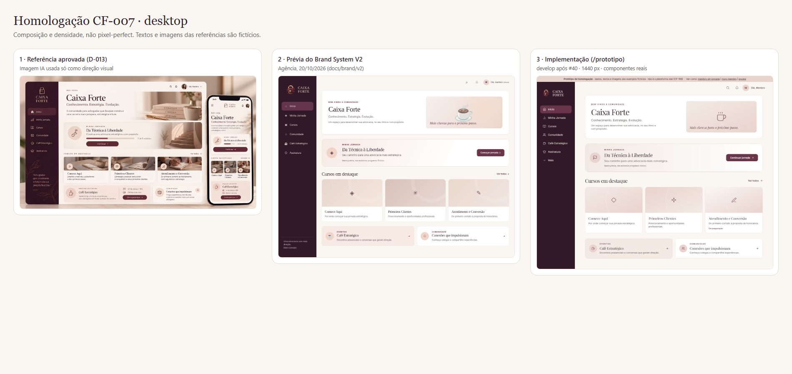
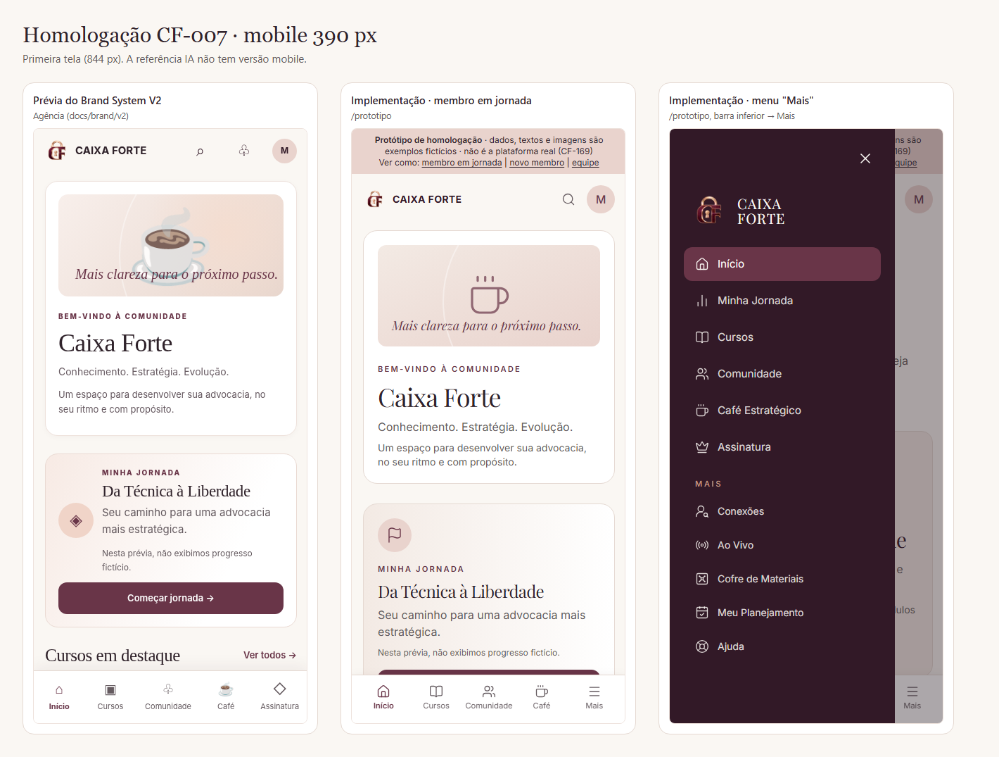

# Homologação CF-007 — layout minimalista e ativos (Issue #9)

**Para:** Ellen (aprovação) · **Preparado por:** Luiggi · **Base:** `develop` após #40 (20/10/2026)

**Critério de aceite (doc C):** Ellen aprova desktop e mobile com 1 hero, 1 jornada, até 3 cursos e 2 blocos auxiliares; mock sintético não vira foto real.

A aprovação é da **composição e da sensação** (D-013), não pixel a pixel. Textos, cursos e números das telas são exemplos marcados como fictícios. Nenhum dado real é usado.

## Como ver

- **Imagens (sem instalar nada):** as comparações abaixo e as pastas `docs/qa/screenshots/cf-020`, `cf-021` e `cf-022`.
- **Navegando, no computador do Luiggi:** `ENABLE_PREVIEW_ROUTES=true pnpm dev` e abrir:
  - `/prototipo` (membro em jornada) e `/prototipo?estado=novo` (primeiro acesso);
  - `/prototipo/equipe` (painel da equipe);
  - `/design` (marca, cores, tipografia e todos os estados dos componentes);
  - `/` (página pública).
- Ainda **não há staging** para abrir de outro lugar: depende da escolha de hospedagem (P-014, Issue #15).

## Comparação

**Desktop:** referência aprovada × prévia da agência (Brand V2) × implementação.

**Mobile 390 px:** prévia da agência × implementação (home e menu "Mais").

## Checklist para a Ellen

Marque **Aprovado** ou **Ajustar** e escreva o comentário quando houver. Os nomes em "Onde ver" ficam em `docs/qa/screenshots/` (ex.: `cf-022/home-1440` = `docs/qa/screenshots/cf-022/home-1440.png`).

| #   | O que avaliar                                                                            | Onde ver                                   | Aprovado / Ajustar | Comentário |
| --- | ---------------------------------------------------------------------------------------- | ------------------------------------------ | ------------------ | ---------- |
| 1   | Densidade da home: 1 hero + 1 jornada + 3 cursos + 2 auxiliares, muito respiro           | comparações; `cf-022/home-1440`            |                    |            |
| 2   | Hero: "Bem-vindo à comunidade", nome, frase curta e painel no lugar da foto              | `cf-022/home-1440`                         |                    |            |
| 3   | Card da jornada: um único botão; primeiro acesso mostra "Começar diagnóstico"            | `cf-022/home-novo-1440`, `/design#jornada` |                    |            |
| 4   | Progresso só com dado real (o protótipo não mostra barra inventada)                      | `cf-022/jornada-1440`                      |                    |            |
| 5   | Cursos: 3 por linha no desktop, 1 no celular, selo "Em preparação" quando ainda não saiu | `cf-022/home-390`, `cursos-design-390`     |                    |            |
| 6   | Cartões auxiliares: Café Estratégico e Comunidade                                        | `cf-022/home-1440`                         |                    |            |
| 7   | Sidebar: 6 destinos + "Mais" (Conexões, Ao Vivo, Cofre, Planejamento, Ajuda)             | `cf-021/mais-1440`                         |                    |            |
| 8   | Celular: barra inferior Início, Cursos, Comunidade, Café + "Mais"                        | `cf-021/membro-390`, `membro-390-mais`     |                    |            |
| 9   | Marca: símbolo + nome em creme na sidebar; logotipo horizontal na página pública         | `cf-004/publico-1440`, `/design#marca`     |                    |            |
| 10  | Cores do Brand V2 (ameixa, vinho, creme, rosé, champagne)                                | `/design#cores`                            |                    |            |
| 11  | Tipografia: Playfair Display nos títulos, Inter no restante                              | `/design#tipografia`                       |                    |            |
| 12  | Painel da equipe: mesma linguagem, mais espaço para tabelas, sem números inventados      | `cf-020/equipe-1440`                       |                    |            |

## Pontos em que a implementação difere da prévia da agência (decidir)

| #   | Diferença                                                                    | O que fizemos e por quê                                                                                                             | Opção                                                                 |
| --- | ---------------------------------------------------------------------------- | ----------------------------------------------------------------------------------------------------------------------------------- | --------------------------------------------------------------------- |
| A   | 5º item da barra mobile                                                      | **"Mais"**, como pede o mapa de navegação do kit (`06_SCREEN_BLUEPRINTS/NAVIGATION_MAP.md`). A imagem da prévia mostra "Assinatura" | manter "Mais" ou trocar por "Assinatura" (aí "Mais" iria para o topo) |
| B   | Card da jornada no celular                                                   | Ícone **acima** do título; na prévia fica **à esquerda**                                                                            | ajuste pequeno, se preferir o da prévia                               |
| C   | Frase no rodapé da sidebar ("Uma advocacia com mais direção. Ellen Conrado") | **Não incluída**: é texto de marca com o nome da Ellen e a integração com o portal dela é fase futura (D-001)                       | aprovar a frase para entrar                                           |
| D   | Ícones                                                                       | Conjunto de linha fina (lucide), o kit não define um set                                                                            | aprovar ou indicar outro                                              |
| E   | Capas dos cursos                                                             | Gradiente da marca + ícone, **sem foto**                                                                                            | aguardam capas reais (CMS, CF-081)                                    |

## Ativos de produção ainda pendentes (P-006)

- [ ] Fotografias reais **autorizadas** para o hero e as capas (hoje: painéis sem foto). O rosto da referência é gerado por IA e **não** é usado.
- [ ] Master vetorial (SVG/AI) do símbolo 3D — só um designer pode redesenhar; o SVG simplificado do kit não é logo oficial.
- [ ] Confirmação final de HEX e fontes (a agência entregou como "propostos para homologação").
- [ ] Registro de marca e titularidade das artes.

Os itens pendentes **não bloqueiam** aprovar o layout. Eles entram quando chegarem, sem mudar a estrutura.

## Como registrar o resultado

1. Ellen devolve o checklist preenchido (comentário na Issue #9 ou mensagem ao Luiggi).
2. Cada **Ajustar** e cada escolha de A–E vira Issue própria com prioridade, sem segurar o restante.
3. A aprovação entra no `docs/D_DECISION_LOG.md` como decisão confirmada, com a data.
4. A Issue #9 fecha com o link para esse registro. A aprovação é o gate para levar o shell e a home para `main`.
